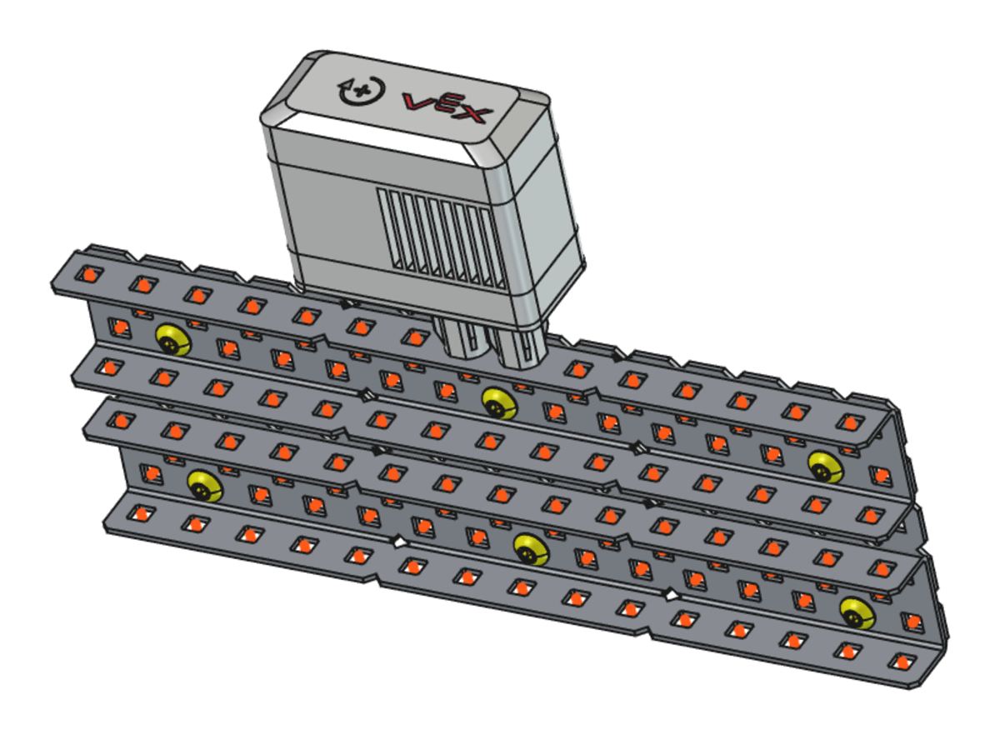
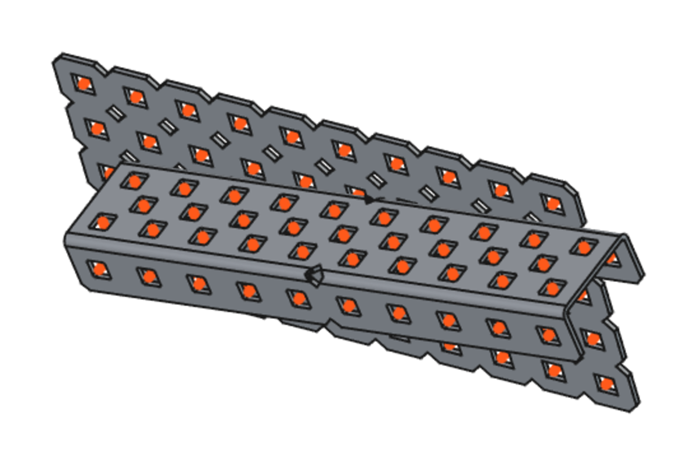
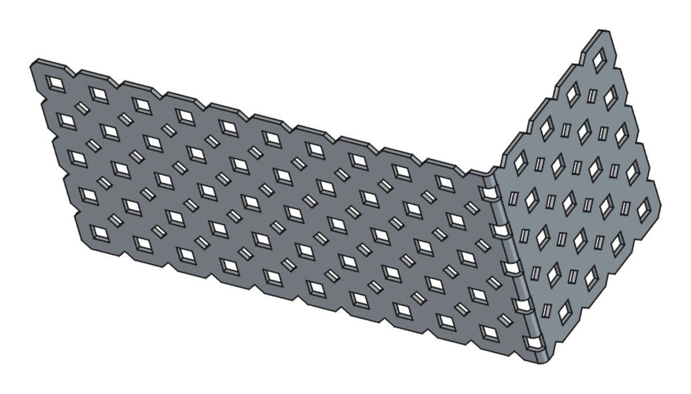

# VEX Workbench

A FreeCAD 1.1 workbench for designing VEX V5 robots in real CAD, with every part at its exact size instead of 'close enough'.



It makes the parts, lines them up hole to hole, and does the joints with FreeCAD's own Assembly workbench, so what's on screen is what gets built. Two channels joined hole to hole land exactly on top of each other, not a hair off d(๑˃ᴗ˂̵)b

## Quick start

1. Install FreeCAD 1.1, then the workbench (see [Installing](#installing)), and restart FreeCAD.
2. Switch to the **VEX** workbench and hit **VEX parts**. Place two C-channels.
3. **Align**: click a hole on one channel, then a hole on the other. The first one moves over so the holes line up and the faces sit flat.
4. Close Align, then **Screw**: click the hole on the head side, then the one on the nut side. In go the right length screw and a nut.
5. **Parts list** counts everything you placed, with weights.

The [usage guide](docs/using.md) goes through every tool.

## What's in it

### Parts

- **A parts dock** with search. The part families sit at the top (greyed out ones don't have a generator yet), and everything else is in folders laid out like the Fusion 360 library.
- **Generated parts**, built from the numbers in [`parts.toml`](freecad/vex_workbench/data/parts.toml) and checked against VEX's own files:
  - C-channel, U-channel, angles (including 1x1s cut down from 3x channel), plates and bars, every length up to 35 holes (20 for U-channel), with the bends, count notches and bend reliefs
  - LS, HS and pitch shafts, standoffs, spacers and washers
  - star (Torx) and hex screws from 0.25 to 2.5 in, Robosource shoulder screws, the thin nylock, and nuts in other materials
- **VEX's own STEP files** for everything else (motors, wheels, gears, sensors, electronics), with their colors. They ship with the workbench.
- **Editable placed parts**: change Holes or Size on a placed part and only that one changes. The same part placed 40 times is one model and 40 links.

### Putting a robot together

- **Hole dots**: while a tool is open, every hole you can use gets a dot to click, on both sides of the metal. On motors, that's just the real mounting holes, not the vents.
- **Align**: click a hole on the part to move, then the hole it goes against. It keeps the way the part was turned (rounded to the angle step), and after that you can turn it by any angle or give it a gap. It can move a whole link array, or the whole sub-assembly a part is in.
- **Screw**: two clicks and the shortest screw that reaches through the nut goes in, nut and all, or 3/8" into a threaded hole (a standoff, a motor) with no nut. Or pick the screw yourself and place it with one click.
- **Spacers**: click two holes facing each other, like inside a boxed channel, and the gap fills with spacers and washers. The screw tool can fill its gaps too.
- **Frame on hole**: a frame on a hole's exact center, for joining parts by hand in the Assembly workbench.
- In an assembly, screws, nuts, spacers and aligned parts all get revolute joints, so they can still spin.



### Shop work

- **Bend**: click a hole and the metal folds there, across or along the part, by any angle, with VEX's 0.032" inside radius.
- **Cut**: the same kind of line, cut to length or take a flange off. Plain sawn edge.
- **Drill**: click a spot and a round hole goes through, snapped to the 0.25" grid (hold Shift for exactly where you clicked).
- Only that one copy changes, and it still counts as the plain part in the parts list, since that's what you buy.



### Extras

- **Colors and weights** per material, and star screw heads in VEX's color code for their length.
- **Parts list** counts every placed part into a spreadsheet, with the weight of each and the total.

## Installing

You need FreeCAD 1.1.

**With the Addon Manager:** in FreeCAD, go to Edit > Preferences > Addon Manager and add `https://github.com/Cloveian/vex-workbench` (branch `main`) under Custom repositories. Then open Tools > Addon Manager, find **VEX Workbench**, install it and restart FreeCAD.

**By hand:** clone the repo into FreeCAD's `Mod` folder and restart FreeCAD:

```
git clone https://github.com/Cloveian/vex-workbench ~/.local/share/FreeCAD/v1-1/Mod/vex-workbench
```

That's the Linux path. On Windows the folder is `%APPDATA%\FreeCAD\v1-1\Mod`, and on macOS it's `~/Library/Application Support/FreeCAD/v1-1/Mod`. If yours is somewhere else, `App.getUserAppDataDir()` in FreeCAD's Python console prints the folder `Mod` goes in. To try it without installing, run `freecad -M .` from inside a clone.

It's about a 140 MB download, mostly VEX's STEP files.

### VEX's STEP files

The VEX parts you'd put on a V5 robot ship with the workbench, gzipped in `freecad/vex_workbench/steps/`. They're VEX's files, so this repo's license doesn't cover them. The kits, the field element, the Legacy (Cortex) parts and the V5 Controller don't ship, and neither do the steps the tests check the generated parts against. To get all of those, download everything into `vex-step/`:

```
uv run tools/fetch_vex_cad.py
python tools/sort_vex_step.py --apply
```

The first one drives Firefox through VEX's CAD search using your Firefox cookies, and downloads every V5 file into `downloads/vex-v5/`. If a bot check comes up, do it in the Firefox window and it carries on. The second sorts them into `vex-step/`, and needs `gh` (the GitHub CLI) to read the Fusion 360 library's folders. After a new download, `python tools/ship_steps.py` zips the shipped set again.

## Known limits

- Joints on a hole that a bend moves or a cut takes off break, so bend and cut before screwing things on. Joints on holes that stay put carry over.
- That's for joints on hole frames, which is what the VEX tools make. One made with FreeCAD's own joint tool straight on a face or edge of a part breaks when that part changes size or gets bent, cut or drilled, since its faces get renumbered.
- Channels and angles only bend away from their other walls. Cut the flanges off first to fold the other way, like you would for real.
- Aluminum C-channel uses the steel channel's hole layout. VEX's own aluminum files are a little different.
- The HS lockbar and drilled gears aren't there yet, there are no numbers for them.

## Tests

```
python tests/test_catalog.py
python tests/test_metal.py
python tests/test_parts.py
python tests/test_library.py
python tests/test_snap.py
env QT_QPA_PLATFORM=offscreen freecad -M . tests/test_gui.py
```

Run them one at a time, with a python that can `import freecad` (the system one, if FreeCAD came from your package manager). All of them except `test_catalog.py` need FreeCAD, and `test_metal.py`, `test_parts.py` and `test_gui.py` need the full download in `vex-step/` too.

## Docs

The [usage guide](docs/using.md) covers every tool. The design notes, roadmap and dev log are in [`docs/`](docs/index.md), as an mkdocs site (`mkdocs serve`, with mkdocs-material).

## License

The workbench is [LGPL-2.1-or-later](LICENSE), same as FreeCAD. The STEP files in `freecad/vex_workbench/steps/` are VEX Robotics' own CAD, shipped as they come (just gzipped).
